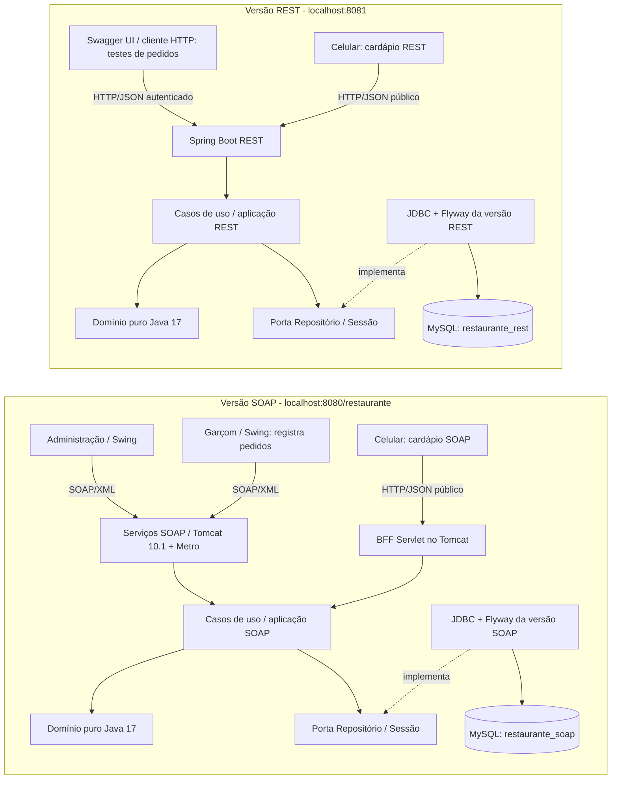

# Arquitetura do sistema restaurante

O laboratório possui duas versões independentes: uma SOAP e outra REST
Cada versão tem seu próprio banco de dados.

As duas reutilizam o código das regras de negócio, mas não compartilham os dados. 
Um pedido criado no SOAP não aparece automaticamente no REST.

## Onde o garçom faz o pedido? 
Na versão SOAP, o garçom utiliza a janela Swing `Tela de pedidos`:

1. Selecione a mesa
2. Clica em `Abrir pedido`
3. Seleciona o produto e marca a quantidade
4. Clica em `Adicionar`
5. O servidor SOAP verifica as regras e grava em `restaurante_soap`
6. Ao finalizar o atendimento, clica em `Fechar conta`

## Como os pedidos são feitos na versão REST?
A API REST também oferece operações para abrir pedidos, adicionar itens e fechar contas.
No tutorial atual, essas operações são testadas pelo Swagger UI ou por um cliente HTTP, com autenticação. Os dados ficam em `restaurante_rest`
Ainda não existe uma tela de atendimento do garçom ligada a API REST.

## Para que serve o cardápio no celular?
Consultar categorias, produtos, descrições e preços

Cardápio SOAP consulta os dados da versão SOAP
Cardápio REST consulta os dados da versão REST

Nenhum dos dois permite registrar pedidos na implementação atual

## Por que os componentes aparecem duas vezes?

Cada aplicação executa suas próprias instâncias dos casos de uso,
do domínio e da infraestrutura de persistência.

Reutilizar o mesmo código Java não significa compartilhar o mesmo banco.

## O que representa a seta pontilhada?

A seta `implementa` indica que o repositório JDBC fornece a implementação
da interface `Repositorio`, utilizada pelos casos de uso.

Ela representa uma relação entre componentes do código.
Não representa sincronização entre os bancos 

